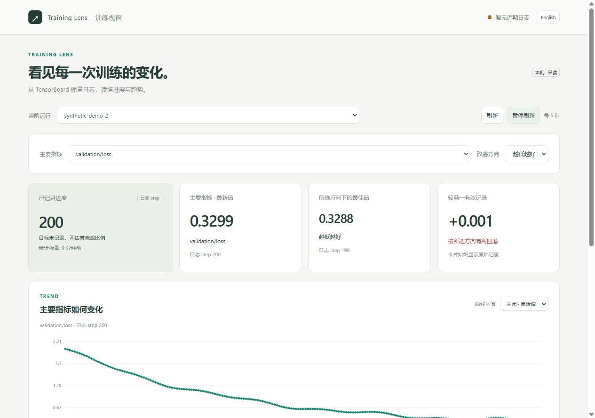

# Training Lens · 训练视窗

为 **DeepSeek Harness（DSH）** 提供简洁的本地训练监控。直接读取训练器已经写好的 TensorBoard 标量，不需要改训练代码，也不依赖 TensorBoard 网页启动。

[English](README.md)



截图使用生成的演示数据，不代表真实训练结果。

## 看什么

- 自选主要 / 辅助指标：奖励、验证损失、准确率、学习率以及任意自定义标量。
- 自选“越高越好 / 越低越好”；默认不预设方向，显示历史范围。
- 原始数值、可选 EMA 平滑、指标自己的记录 step、可展开的全部标量和异常值提示。
- 中英文切换、窄屏布局、运行切换、每五秒自动刷新。

## 安装

需要 DSH 0.2.1-rc.2（已测试的目标版本）、Node 22+，以及已安装 TensorBoard 的 Python 3.10+ 训练环境。

```sh
dsh plugin --profile desktop add dsh-training-lens@0.2.0
```

也可以从源码安装；包内是可直接运行的 JavaScript，不需要安装时构建：

```sh
dsh plugin --profile desktop add github:GU143312/dsh-training-lens#v0.2.0
```

安装后在方便的时候重载插件并刷新页面，或重启 DSH。`desktop` 可换成自己的 profile。也可以将 GitHub Release 中的 `.tgz` 本地路径传给同一条 `add` 命令。

## 一键打开与自动启动

DSH 侧栏底部及本插件详情页都有 **训练视窗** 按钮。首次打开，填写 TensorBoard 日志目录的绝对路径及训练环境 Python，点击 **启动并查看**。监控会直接显示在面板中，也可点击 **在新标签页打开**；无需查找或记住端口。

启动方式可选择：

- **手动启动**：默认方式，只在你点击按钮或调用工具时启动。
- **随 DSH 启动**：保存后立即启动，之后每次载入插件都会打开监控服务。
- **检测到日志写入时启动**：每 5 秒检查你指定的日志目录，发现新建或发生变化的 TensorBoard 事件文件时启动；首次启用也识别最近 15 秒内更新的日志。目录可以由训练器稍后创建。不会扫描其他项目，也不会因为旧历史日志自动启动。

**停止监控** 会暂停本次插件会话的自动启动，之后的日志写入不会重新拉起监控；再次保存设置可恢复。检测日志写入不等于知道训练进程启动、停止或成功。监控打开后会继续刷新，训练结束不强制关闭页面。

面板设置保存在当前 DSH profile 目录的 `training-lens.settings.json`，重启和升级后可复用，并优先于下面的初始配置。每个 profile 独立保存，不写入插件安装目录或训练目录。无 profile 路径的自定义宿主仅保存本次会话设置。自动启动只启动服务，不会主动弹出浏览器窗口；随时点击侧栏按钮即可查看。

在远程 DSH 中，面板显示转发提示及实际地址，不会尝试把远程回环地址嵌入本机页面。先使用自己的 SSH / 编辑器端口转发。

## 通过聊天启动

在 DSH 中说：

> 请用 training_lens 打开我的 TensorBoard 日志，目录是「日志目录的绝对路径」，Python 是「训练环境 Python 的完整路径」。

Windows 的解释器通常在 `.venv\Scripts\python.exe`；Linux/macOS 通常在 `.venv/bin/python`。插件返回一个本机网页地址，打开后选择运行、主要指标和改善方向。

之后可以说“查看训练视窗状态”或“关闭训练视窗”。关闭的只是监控进程，训练不受影响。插件卸载、重载或 DSH 退出时，自己启动的监控会被清理。每个插件实例同时管理一个监控；更换目录或解释器前请先关闭。

## 依赖与配置

优先复用已有训练 Python。缺少 TensorBoard 时，在源码目录用该解释器执行 `python -m pip install -r requirements.txt`。插件不会自动安装或修改依赖，也不读取账号、凭证或训练模型。

默认自动选择空闲端口，仅监听 `127.0.0.1`；指定端口被占用时会报错，不会终止其他服务。可在 profile 的 `cordis.patch.yml` 为 `training-lens` 设置 `python`、`logdir`、`port`、`staleSeconds`、`startupTimeoutMs`、`startMode`（`manual`、`startup` 或 `activity`），示例见 [英文说明](README.md#configuration)。

## 如何理解页面

- 状态灯只反映日志新鲜度，不证明训练进程仍然健康。达到目标 step / epoch 也不代表模型已保存或训练成功。
- 各指标可能有不同的更新频率，卡片注明自己的 step。普通训练不假设 step 就是 epoch；仅在已知日志约定下展示配置目标。
- 不从奖励推算成功率，不从损失下降宣称泛化改善。不同指标的图表纵轴独立。
- 非有限值留空并断开曲线。长序列仅为绘图降采样，卡片统计仍使用完整已读序列。
- 支持普通 scalar 和 TF2 scalar-plugin tensor。超大的混合媒体日志可能占用较多内存，请选择明确的训练日志目录。
- 日志留在本机，无遥测、无云端上传。远程 DSH 的网页运行在远程主机，请使用已有 SSH / 编辑器端口转发。

## 开发与许可

`npm ci --ignore-scripts`、`npm run check`、`npm test`，以及 `python -m unittest discover -s tests -p 'test_*.py' -v`。设置 `TRAINING_LENS_TEST_PYTHON` 后启用真实子进程生命周期测试；缺少可选 Python 依赖时，相关测试明确跳过。测试不启动真实训练。

MIT 开源许可；依赖保留各自许可证。安装包只包含必要的代码、静态资源和说明，不包含运行数据、个人目录、模型或原项目文件。
